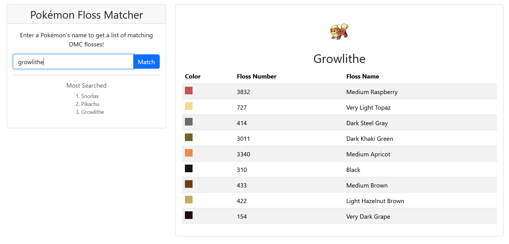

# Pokémon Floss Matcher
This tool provides users with a list of DMC embroidery floss colors to use when stitching up their favorite Pokémon.

## Demo

[Live Demo](https://pokemon-floss-matcher-xy2a.onrender.com/)

## How It Works

When a Pokémon is matched, the program first checks for the existence of a cached result. If none exists, it queries
PokéAPI for the Pokémon's image link. That image is saved, and its color palette extracted using the Color Thief 
library. Each color is then converted RGB → XYZ → LAB for comparison to the floss colors.

Finding the closest match to a reference is not as simple as comparing the RGB values and selecting the color with 
the smallest difference in values compared to the original. RGB distance does not translate to the human eye's 
perception. Take the following RGB values: (255, 255, 255) and (255, 127, 255). These differ in a single value by 78, 
but the colors are visually very different (white and light fuchsia). Now take the values (0, 255, 0) and (0, 255, 127). 
These differ in a single value by 127, but are two similar shades of green. 

To compare colors more accurately from the perspective of the human eye, they must be converted to CIELAB color space. 
This is a perceptually uniform color space where numerical differences correspond to equal perceived color differences. 
Colors are then compared using the CIE76 color difference formula, developed in 1976. While more complex formulas have 
since been developed to address CIELAB's imperfections, CIE76 is well suited for this application's purpose.

Upon pairing every extracted color with its closest matching floss, the results are packaged alongside the Pokémon's 
name and image into a match result. This result is both returned to the user and cached locally. The next time this 
Pokémon is searched, the cached result is returned instantly without repeating the entire pipeline.

Every successful match, whether it comes from the cache or the full pipeline, also increments that Pokémon's search
count in a PostgreSQL database. Failed lookups, like misspelled names, are not counted. The "Most Searched" panel shows
the top three through a `/api/pokemon/popular` endpoint and refreshes after each match. The database schema is managed
with Flyway migrations, so a brand-new database is built automatically on the first startup.

## Tech Stack
**Frontend:**
- React 19
- TypeScript
- Bootstrap 5
- Vite 7

**Backend:**
- Java 21
- Spring Boot 3.5
- Spring Web
- Spring Webflux (WebClient for API calls)
- Spring Data JPA
- PostgreSQL
- Flyway (database migrations)
- Maven
- Jackson (JSON serialization)
- Color Thief by Sven Woltmann (color palette extraction)

**Testing:**
- JUnit 5 and Mockito
- H2 (in-memory database for tests)

**Deployment:**
- Docker
- Render (backend web service, managed PostgreSQL, static frontend)

## Installation

### Locally
**Prerequisites**
- Java 21+
- Node.js 22.12+
- PostgreSQL (developed against 18) running on default port 5432
- Git (to clone the repo)

**Steps**
1. Clone the repository.
2. Create an empty PostgreSQL database named `poke_color_matcher` (for example, with pgAdmin).
3. In the terminal you'll use for the backend, set the database credentials as environment variables:
    - Windows (PowerShell): `$env:DB_USERNAME="postgres"; $env:DB_PASSWORD="your_password"`
    - Mac/Linux: `export DB_USERNAME=postgres DB_PASSWORD=your_password`
4. In that same terminal, from the project root, start the backend. Flyway creates the database tables automatically 
on startup.
    - On Windows: `mvnw.cmd spring-boot:run`
    - On Mac/Linux: `./mvnw spring-boot:run`
5. Open a second terminal and navigate to the `frontend` folder.
6. Create a file named `.env.development` in the `frontend` folder containing `VITE_API_BASE_URL=http://localhost:8080`
7. (One time only) Install dependencies: `npm install`
8. Start the frontend server: `npm run dev`
9. Visit `http://localhost:5173` in the browser.

If you've also run the app with Docker, delete the contents of `results/` before starting the backend. Cached results
from the two setups store different image paths.

### With Docker
**Prerequisites**
- Docker Desktop
- Git (to clone the repo)

PostgreSQL runs in its own container, so you don't need to install it.

**Steps**
1. Clone the repository.
2. Create a file named `.env` in the project root containing `DB_PASSWORD=` followed by any password you like.
3. From the project root, build and run the containers: `docker compose up --build`
4. Wait for the backend logs to show `Started PokeColorMatcherApplication`, then visit `http://localhost:3000` in 
the browser. 

**Notes**
- Search history is stored in a Docker volume, so it survives `docker compose down`. Running `docker compose down -v`
  deletes it.
- If you change the password in `.env` after the first run, run `docker compose down -v` to reset the database.
- If you've also run the app locally outside Docker, delete the contents of `results/` before starting the containers.
  Cached results from the two setups store different image paths.

## Planned Improvements
**Features**
- Dropdown or autocomplete for Pokémon selection instead of manual text entry
- Support for alternate Pokémon sprites, including gender differences and special forms
- Proper display for names like "Ho-Oh"

**Technical Improvements**
- Replace Spring WebFlux with RestClient to remove the dual web/webflux dependency
- Replace `System.err.println` calls with proper SLF4J logging
- Gracefully handle database outages so Pokémon matching still works without it
- Upgrade to Spring Boot 4.0

## Known Limitations
**Manual Entry**
Users must manually type in a Pokémon name with no validation beyond an error message.

**Inaccurate Color Extraction**
Color extraction is performed using the Color Thief library, which may not always produce the same palette a human would 
select. Some colors may be slightly off or over/underrepresented.

## Acknowledgements
- [PokéAPI](https://pokeapi.co/) — Pokémon data and sprites
- [Color Thief](https://github.com/SvenWoltmann/color-thief-java) by Sven Woltmann — color palette extraction, 
licensed under [Creative Commons Attribution 2.5](http://creativecommons.org/licenses/by/2.5/)
- [EasyRGB](https://www.easyrgb.com/en/math.php) — color space conversion formulas

*Pokémon and all related names are trademarks of Nintendo/The Pokémon Company.
This is an unofficial fan project with no affiliation.*